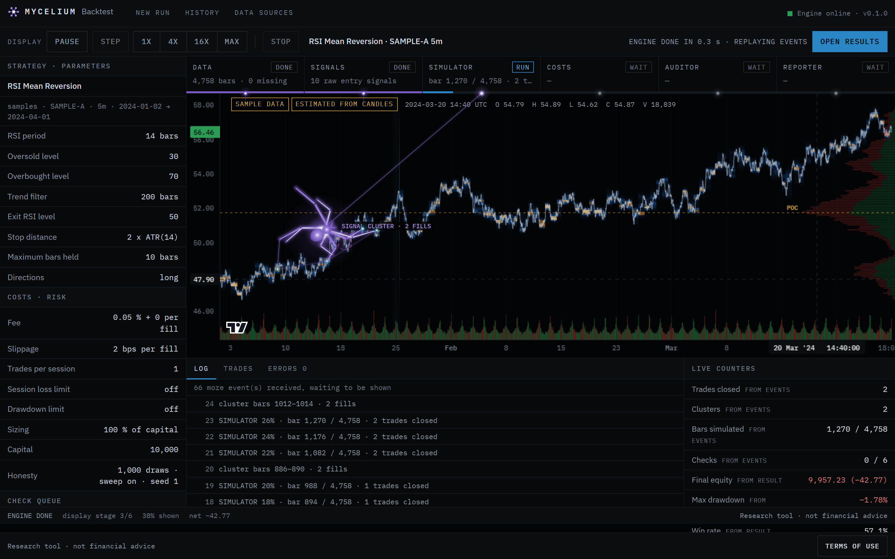
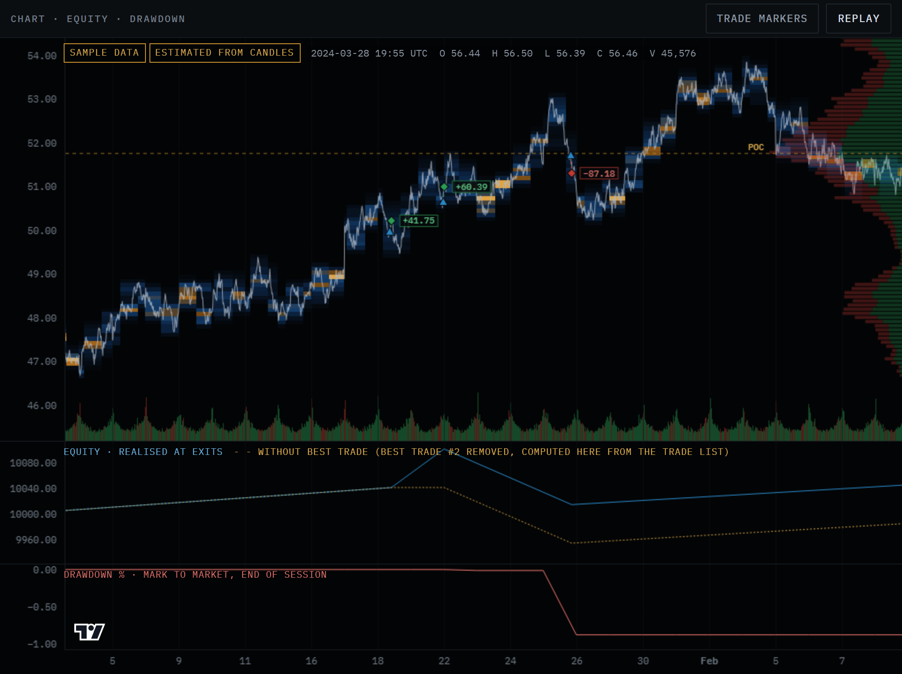

# Mycelium Backtest

Mycelium Backtest runs a trading strategy on past market data and tells you how much of the result survives an honesty check. Every run is tested for six problems: costs left out, too few trades, one lucky trade, rules tuned on the same data, a result that random entries match, and a result that depends on one period or one parameter choice. The verdict is credible, fragile or not credible, and the report shows the rules that decided it.

Live site: [https://mycelium-backtest.vercel.app/](https://mycelium-backtest.vercel.app/)

While a run executes, a canvas crawler on the chart follows the engine's real events. It may lag the engine, never lead it.

Research tool, not financial advice.

## Screenshots



Run screen while the engine's events are replayed. Sample-data run (`SAMPLE-A`, RSI Mean Reversion), not real market data.



Results chart with heatmap, trade markers, equity and drawdown. Sample-data run, heatmap estimated from candles.

### Demo

<video src="docs/screenshots/demo.mp4" controls muted width="100%"></video>

[Watch the demo (docs/screenshots/demo.mp4)](docs/screenshots/demo.mp4)

Recorded run on sample data (SAMPLE-A), not real market data.

## The hosted site has no live engine

The public site is a static page. It shows a recorded run on synthetic sample data (labelled `RECORDED RUN · SAMPLE DATA`) and these instructions. It does not run the engine, accept files or store anything. To run backtests, run Mycelium on your own machine as described below.

## What it does

- Five library strategies: Opening Range Breakout, VWAP Mean Reversion, Gap Fade, Donchian Channel Breakout, RSI Mean Reversion. Each has documented parameters and a stop-loss.
- Crypto candles from public Coinbase Exchange and Kraken endpoints, no API key. Stocks and ETFs through your own CSV file, or the labelled synthetic sample sets (`SAMPLE DATA`).
- Heatmap chart, P&L calendar, trade table, replay of a finished run, and a local run history kept in the browser.
- No account, no tracking, no analytics. Imported CSV files are processed in memory and never stored.

Crypto data needs an internet connection. The sample sets and CSV import work offline. Nothing leaves your machine except the public data requests you ask for.

## Run it locally

You need Python 3.12, Node.js 26.13 or a later 26.x release (with npm) and git.

Backend, on port 8417. Windows PowerShell:

```powershell
git clone <repository-url> mycelium-backtest
cd mycelium-backtest\backend
py -3.12 -m venv .venv
.\.venv\Scripts\python -m pip install -r requirements.txt -c constraints.txt
.\.venv\Scripts\python -m app.dev
```

macOS or Linux:

```sh
git clone <repository-url> mycelium-backtest
cd mycelium-backtest/backend
python3.12 -m venv .venv
./.venv/bin/python -m pip install -r requirements.txt -c constraints.txt
./.venv/bin/python -m app.dev
```

Frontend, on port 5417, in a second terminal opened in the repository folder (same commands on every system):

```sh
cd frontend
npm install
npm run dev
```

Open http://localhost:5417 and accept the terms once. The frontend proxies `/api` to the backend on port 8417. Stop either server with Ctrl+C.

Optional settings are listed with placeholder values in `backend/.env.example` and `frontend/.env.example`; the defaults work without copying them.

## Checks

From `backend/` (with the virtual environment's Python):

```sh
python -m ruff check .
python -m ruff format --check .
python -m pytest
```

Install the test tools first with `python -m pip install -r requirements-dev.txt -c constraints.txt`.

From `frontend/`:

```sh
npm run lint
npm test
npm run build
```

## Hosted static build

`VITE_HOSTED=1 npm run build` in `frontend/` produces the static site: every `/app` address redirects to the run-it-locally section and the app code is not emitted. `VITE_REPO_URL` sets the address of the "View on GitHub" links. `frontend/vercel.json` holds the single-page-app rewrite and the security headers for Vercel.

## Disclaimer

Research tool, not financial advice. A backtest describes how a set of rules behaved on past data. It can make mistakes and it does not predict future results.
